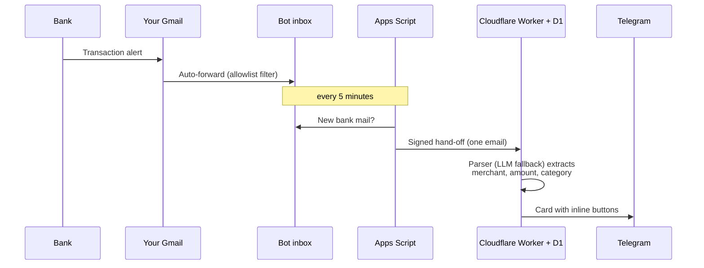
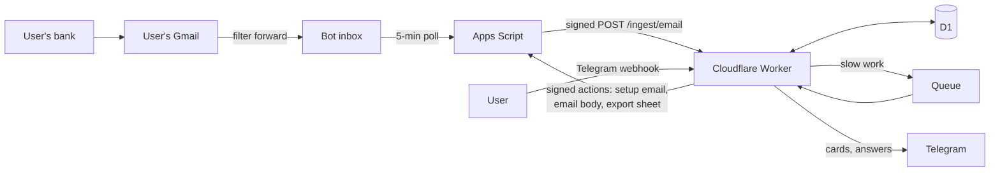

# 💰 Dus Aane Bot

  <b>Splitwise that fills itself in — from your bank emails and SMS.</b>

  <a href="https://t.me/dusaanebot">💬 Try the bot</a> ·
  <a href="#-as-a-user">📖 User guide</a> ·
  <a href="#-as-an-operator-self-host">🛠 Self-host</a> ·
  <a href="https://github.com/Rrishik/dus-aane-bot/stargazers">⭐ Star this repo</a>

  
  
  
  
  

Forward a bank email or paste a bank SMS; the bot reads it, categorises it, and sends you a card. Tap one button to split it 50/50 with your partner — the group chat gets a notification, the math is done. Ask `/ask how much on food this month?` in plain English. No data entry, no app to install, no full-Gmail OAuth grant to a black box.

<!--
Screenshots are hidden until assets/ exists. To publish them: add the files
below, then move the hero block back above the tagline and the gallery back
under a "## See it in action" heading.

Shot list (phone, dark mode; sanitise names to Alice / Bob and use made-up amounts):
  assets/hero.png             wide 1280x640 banner: logo + phone mockup of a transaction card.
                              Also upload under GitHub Settings, Social preview.
  assets/demo.gif             10 s loop: forwarded bank email, card arrives, Split with Flat,
                              50-50, group notification and the pinned live balance updating
  assets/01-txn-card.png      a transaction card: "Split with <group>" row, then the
                              merchant pill, category pill and the overflow (three dots) button
  assets/02-sms-paste.png     pasting a bank SMS into the chat and the card it becomes
  assets/03-group-split.png   the group notification ("Alice paid", each share) plus the
                              pinned live-balance message
  assets/04-stats.png         group /stats ("who owes whom") with the Simplify button
  assets/05-ask.png           /ask question and answer with the Follow up button

Hero block (goes right after the "# 💰 Dus Aane Bot" title):

  

Gallery (under "## See it in action"):

  

<table>
  <tr>
    <td></td>
    <td></td>
  </tr>
  <tr>
    <td align="center"><em>Every bank email becomes a one-tap card.</em></td>
    <td align="center"><em>Paste an SMS; same card.</em></td>
  </tr>
  <tr>
    <td></td>
    <td></td>
  </tr>
  <tr>
    <td align="center"><em>Splits land in the group chat automatically.</em></td>
    <td align="center"><em><code>/stats</code> rolls every split into a settlement.</em></td>
  </tr>
  <tr>
    <td colspan="2"></td>
  </tr>
  <tr>
    <td colspan="2" align="center"><em>Ask in plain English: <code>/ask</code> calls structured tools, not RAG.</em></td>
  </tr>
</table>
-->

## Why not just use CRED, Walnut, or Splitwise?

Closed-source finance apps typically ask for **full Gmail read access** via OAuth — which lets them scan everything: OTPs, statements, personal mail, receipts, newsletters. You trust them to look only at what they claim.

Dus Aane Bot inverts that:

|                                       | CRED / Walnut / etc.                          | Dus Aane Bot                                                                  |
| ------------------------------------- | --------------------------------------------- | ----------------------------------------------------------------------------- |
| **Access scope**                      | Full Gmail read (all mail, all labels)        | Only emails you forward to the bot inbox                                      |
| **OTPs / statements / personal mail** | Readable by the app                           | Never leaves your Gmail                                                       |
| **Data location**                     | Their servers, their schema                   | Your own deployment (self-hostable), scoped to your chat                      |
| **Export / delete**                   | Via their UI, if offered                      | `/export` (CSV or Google Sheet) and `/deletemydata`, any time                 |
| **Source code**                       | Closed                                        | [This repo](https://github.com/Rrishik/dus-aane-bot) — audit before you trust |
| **Revoke access**                     | OAuth revoke (still had full read until then) | Delete the Gmail filter                                                       |
| **Shared expenses**                   | Manual entry (Splitwise) or absent            | One-tap split, group chat notification, settlement math built in              |

## What the bot can — and can't — see

> **The bot never sees:** OTPs · bank statements · personal email · receipts · newsletters · anything else in your inbox.
> **The bot only sees:** emails from ~30 verified bank addresses that you explicitly forward.

The trust model is a one-time Gmail filter that matches a **fixed allowlist of verified bank sender addresses** (see [`TRANSACTION_SENDERS`](Constants.js)). Nothing else is ever forwarded. If you don't trust the allowlist, read it — it's in this repo.

## Who it's for

- 👫 **Couples** — one of you registers, the other gets added to a 2-person group. Every bank email becomes a card; one tap splits it 50/50. `/stats` shows who owes whom.
- 🏠 **Roommates** (up to 4) — same idea, with `Split with everyone`, `Split with everyone except X`, and `Just me + person Y` modes for the messy edge cases.
- ✈️ **Friends on a trip** — spin up a group, share expenses for the trip duration, run `/stats` in the group and tap 🔀 Simplify at the end to settle in the fewest transfers.
- 🧑‍💻 **Anyone who wants automated personal expense tracking** — works fine solo; you just never tap the Split button.

## How it works

1. Each user sets up a Gmail filter that forwards only verified transaction-alert senders (see [`TRANSACTION_SENDERS`](Constants.js)) to the bot inbox.
2. Every 5 minutes a small Apps Script project checks the bot inbox, drops anything that isn't from a bank, and hands each email to the Worker.
3. The Worker works out who forwarded it, reads it, saves it to D1 and sends that user a card with buttons for tag, category, splitting and an overflow (⋯) menu.

You can also **paste bank SMS** straight into your DM with the bot — each one becomes a card immediately, no polling involved. Everything you do in Telegram (buttons, `/ask`, groups) is handled by the Worker directly.

The Gmail filter on the user's side is the **primary privacy boundary** — the bot literally never sees mail that doesn't match the allowlist.

## Features

- ⚡ **Deterministic parser first** — bank templates plus generic rules read amount, direction, date, merchant, account and reference without an LLM call. Every read is validated (the amount must appear in the text, dates must be recent); low-confidence reads become "⚠️ Check this" cards.
- 🤖 **LLM fallback** — Azure OpenAI with tool calling handles formats the parser can't read. Tap **⋯ → 🔄 Re-read** on a parser-read card to have the LLM read it again and pick the better result.
- 📱 **SMS paste** — paste one or several bank SMS into the chat. The same payment arriving by email and SMS becomes one transaction (matched on reference number, or account + amount + date); the same SMS twice is caught.
- 👫 **One-tap splits** — `50–50` / `They owe 100%` / `Split with all` / `Everyone except X` / `Just me + Y`, plus 🤝 Settle up. Group `/stats` shows who owes whom with optional minimum-transfer simplification, and a pinned message keeps live balances.
- 💬 **`/ask` in plain English** — structured tools over your own data (summaries, category breakdowns, top merchants, search), and it can fix a category or split a transaction when you ask it to.
- 📤 **Your data, any time** — `/export` sends a CSV (all time, a month or a date range) with an **Open in Google Sheets** button; `/deletemydata` removes everything.
- 🧠 **Self-improving merchant map** — your 🏷 Tag and 📂 Category taps teach the bot for your future transactions only; admin-curated shared defaults give new users a head start.
- ⏪ **`/backfill`** — reprocess any date range of forwarded mail with progress updates.
- 🔒 **Allowlist-only ingestion** — the bot only sees emails matching ~30 fixed bank senders. OTPs, statements, security codes and personal mail never leave your Gmail.
- 🚀 **CI/CD** — every push to `main` is tested, then deployed to Cloudflare and Apps Script, with a smoke test at the end.

## Get started

### 👤 As a user

1. **DM the bot** → [@dusaanebot](https://t.me/dusaanebot) → `/start`.
2. **`/register your.email@gmail.com`** — the bot emails you a 3-step Gmail auto-forwarding setup (add forwarding address → verify → create filter) with a one-tap **Verify forwarding address** button.
3. **Forward any bank email (or paste a bank SMS)** — your first transaction activates the account and its card arrives.

From here, every matching transaction email auto-forwards; its card arrives within about 5 minutes. Full flow details: [User onboarding](#user-onboarding).

### 🛠 As an operator (self-host)

Want to host it for your friend group? One deployment serves everyone — they self-onboard with `/start`.

<b>Self-host setup</b>

#### Prerequisites

- A dedicated Gmail account for the bot (all forwards land here)
- A Telegram bot token ([@BotFather](https://t.me/BotFather)), an Azure OpenAI deployment, a Cloudflare account
- Node.js 24 and `npm install -g @google/clasp`

#### One-time setup

1. **Fork** this repo. If you use a different bot inbox, change `BOT_INBOX_EMAIL` in [Constants.js](Constants.js) and [worker/src/app/constants.js](worker/src/app/constants.js).
2. **Apps Script project** — `clasp login` as the bot Gmail → `clasp create --type standalone --title "dus-aane-bot" --rootDir .` → `clasp push` → open the script editor and authorize the scopes (Gmail, Gmail send, Sheets, Drive, URL fetch). Deploy it as a **Web App** (execute as the bot account, access: Anyone) and note the `/exec` URL and deployment id.
3. **Cloudflare** — create the database (`npx wrangler d1 create dus-aane-bot`) and put its id in [worker/wrangler.toml](worker/wrangler.toml). Create an API token with Workers, D1 and Queues edit rights. Deploy once (`npx wrangler deploy` in `worker/`) to get the Worker's URL.
4. **GitHub secrets** — `BOT_TOKEN`, `WEBHOOK_SECRET` and `INTERNAL_SECRET` (random, `[A-Za-z0-9_-]{32,}`), `GROUP_CHAT_ID` (your Telegram chat id, for admin messages), `AZURE_OPENAI_ENDPOINT` / `_API_KEY` / `_DEPLOYMENT_NAME` / `_API_VERSION`, `WORKER_PROXY_URL` (Worker URL), `SCRIPT_APP_URL` (`/exec` URL), `CLASP_TOKEN` (contents of `~/.clasprc.json`), `DEPLOYMENT_ID`, `CLOUDFLARE_API_TOKEN`.
5. **Push to `main`** (or run **Actions → Deploy**). CI applies the D1 schema, deploys the Worker and Apps Script, points Telegram's webhook at the Worker and runs a smoke test.
6. **Gmail trigger** — in the script editor, run `installEmailTrigger()` once.

That's it — share the bot's Telegram handle; people self-onboard with `/start`. Day-to-day running, diagnosis and secret rotation: [docs/OPERATIONS.md](docs/OPERATIONS.md).

#### Updating the bank sender allowlist

Edit `TRANSACTION_SENDERS` in [Constants.js](Constants.js) to add a new bank (`scripts/gen-gmail-filter.js` prints the resulting filter). Existing users' filters won't match the new sender until they re-paste the filter from a fresh setup email (`/account` → Resend setup). See [docs/CONTRIBUTING.md](docs/CONTRIBUTING.md#adding-a-new-bank) for adding a parser template too.

## User onboarding

**From Telegram:**

1. `/start` — the bot shows the welcome.
2. `/register your.name@gmail.com` — the bot:
   - Reserves your account (pending) keyed to your chat and email.
   - Emails `your.name@gmail.com` a 3-step auto-forwarding setup, with a one-tap **Verify forwarding address** button that auto-confirms Gmail's verification code.
   - Replies with a manual fallback: forward any bank email to `dusaanebot.inbox@gmail.com`, or paste a bank SMS.
3. **First transaction arrives** (forwarded or pasted) — your account activates and you get a welcome. If someone added you to a group before you registered, you join it now.
4. `/account` — view status and registered emails; tap **📬 Resend auto-forwarding setup** if you lost the email.

## Commands

| Command                                              | Description                                                                                              |
| ---------------------------------------------------- | -------------------------------------------------------------------------------------------------------- |
| `/start`                                             | Welcome + onboarding instructions                                                                        |
| `/register [email]`                                  | Claim a Gmail address; emails the auto-forwarding setup steps. Bare `/register` prompts for the address. |
| `/account`                                           | Status, registered emails, one-tap resend of the setup email                                             |
| `/recent [N]`                                        | Recent transactions                                                                                      |
| `/stats`                                             | Dashboard — recent, weekly / monthly trends                                                              |
| `/ask <question>`                                    | Ask about your spending in plain English (e.g. "food spending last month"); 5 a day                      |
| `/export [YYYY-MM \| from to]`                       | CSV of your transactions, with an **Open in Google Sheets** button                                       |
| `/backfill 10m` / `3 days` / `YYYY-MM-DD YYYY-MM-DD` | Re-read forwarded mail from a period                                                                     |
| `/deletemydata`                                      | Delete your account and data (asks first)                                                                |
| `/cancel`                                            | Cancel a pending prompt                                                                                  |
| `/help`                                              | Show commands                                                                                            |

**In a group** (after adding the bot as admin): `/start` sets the group up (or re-syncs members), `/stats` shows who owes whom, `/settle @name 500` records a cash payment, `/account` shows the group's setup, `/help`.

### Transaction cards

Each transaction notification is a two-line card with:

- **Split with <group>** — one row per group you're in; opens the split and settle options. In a single two-person group the card offers **👥 50-50 with <them>** directly, with **More ▾** for the rest.
- **🏷 <merchant> ▾** — rename the merchant; future transactions from the same payee use the new name.
- **📂 <category> ▾** — pick a category; future transactions from that merchant default to it.
- **⋯** — overflow: **🔄 Re-read** (parser-read cards, once), **✏️ Fix** (money in ↔ out, or the amount), **⚠️ Report error** and **🗑️ Delete**. Fix and Delete are hidden on split cards — tap **↩️ Make personal again** first.

**⚠️ Check this** cards (low-confidence reads, failed validation, suspected duplicates) show **✅ Save / 🔄 Re-read / ✖ Discard** instead and don't count in `/stats` or `/ask` until saved.

### Pasting SMS

Send one or more bank SMS as a plain message in your DM with the bot. Separate several with a blank line (or one per line). OTPs and promos get "No transaction found"; the same SMS twice gets "Already recorded".

## Under the hood

<b>Architecture</b> — request paths, isolation, why tool calling

- **Telegram → Worker.** The webhook carries Telegram's secret-token header; quick taps are answered straight away, while anything that waits on the LLM or Apps Script (`/ask`, pasted SMS, `/export`, Re-read) runs from a Cloudflare Queue so it isn't cut off.
- **Email → Apps Script → Worker.** Apps Script owns the bot's Gmail: it filters new mail and posts each email to the Worker, labelling it only once the Worker accepts it (failures retry for about a day). It also sends the setup email, re-fetches email bodies for Re-read, and creates Export-to-Sheet copies. Both directions are HMAC-signed with a shared secret.
- **Isolation.** Every D1 query is scoped to the caller's Telegram chat id; group data is only visible to that group's members.
- **Scheduled jobs.** One daily cron sends the Friday weekly summary, Tuesday reminders to inactive users, a Monday parser report to the admin, and purges expired state.

### Tool calling (MCP-like pattern)

Both extraction and `/ask` use OpenAI function calling. Tools are defined once, the LLM decides when to call them, and only the tool's response (not the full dataset) enters the context.

**Why not RAG or context injection?** Transaction data is structured — embedding rows into a vector DB adds cost with no benefit, and stuffing all merchant→category mappings into the prompt floods the context window.

**Extraction — 1 tool** (`get_merchant_category`): the LLM categorises well-known merchants directly; calls the tool only for unfamiliar ones.

**`/ask` — 9 tools**: `get_spending_summary`, `get_category_breakdown`, `get_top_merchants`, `get_user_spend`, `search_transactions`, `get_groups`, `update_transaction`, `split_transaction`, and `ask_user` (asks you a follow-up question; reply to it to continue).

<b>Data model</b> — D1 tables

| Table                                                                  | Holds                                                                                                                                    |
| ---------------------------------------------------------------------- | ---------------------------------------------------------------------------------------------------------------------------------------- |
| `tenants`, `tenant_emails`                                             | Users (Telegram chat) and groups; registered forwarder emails                                                                            |
| `transactions`                                                         | One row per payment: date, amount (integer ×100), currency, direction, kind, merchant, category, account last 4, reference, status       |
| `transaction_sources`                                                  | How each transaction arrived (Gmail id or SMS hash, parser template); an email and an SMS of the same payment are two sources of one row |
| `splits`, `split_shares`, `settlements`                                | Group splits, each member's share, and settlements                                                                                       |
| `group_members`, `group_invites`                                       | Group membership (join order matters for old cards) and invites for not-yet-registered people                                            |
| `merchant_rules`                                                       | Name / category rules: each user's own (win for them) and shared defaults                                                                |
| `ask_usage`, `backfill_jobs`, `settings`, `parser_events`, `ephemeral` | `/ask` quota, backfill progress, parser mode, parser telemetry (no amounts or text), short-lived prompts                                 |

Schema: [worker/migrations](worker/migrations). What's stored and for how long: [docs/PRIVACY.md](docs/PRIVACY.md).

<b>Project structure</b>

See [docs/CONTRIBUTING.md](docs/CONTRIBUTING.md#layout).

<b>Troubleshooting</b>

See [docs/OPERATIONS.md](docs/OPERATIONS.md#diagnosis) — the **Diagnose** workflow shows the webhook state, D1 activity and what happened to each recent forwarded email.

## Contributing

See [docs/CONTRIBUTING.md](docs/CONTRIBUTING.md).

## Privacy

See [docs/PRIVACY.md](docs/PRIVACY.md) for what the bot reads, stores and shares, and how to take your data out.

## License

MIT. The code is open — audit it, fork it, self-host it.

## Acknowledgments

- Azure OpenAI for transaction extraction and `/ask`
- Telegram Bot API
- Cloudflare Workers, D1 and Queues
- Google Apps Script (Gmail polling)
